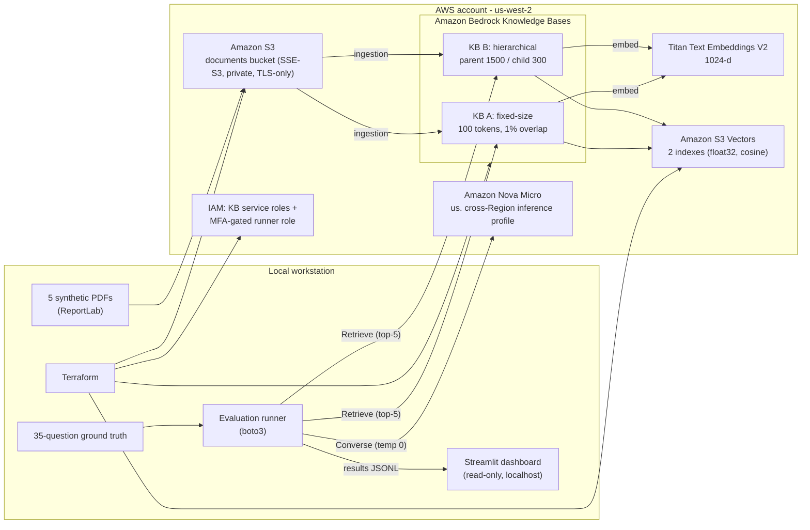
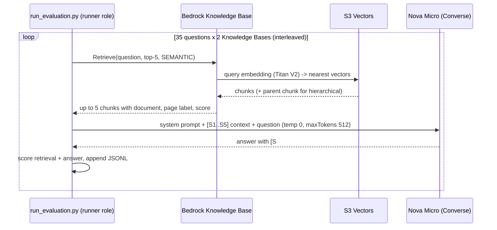
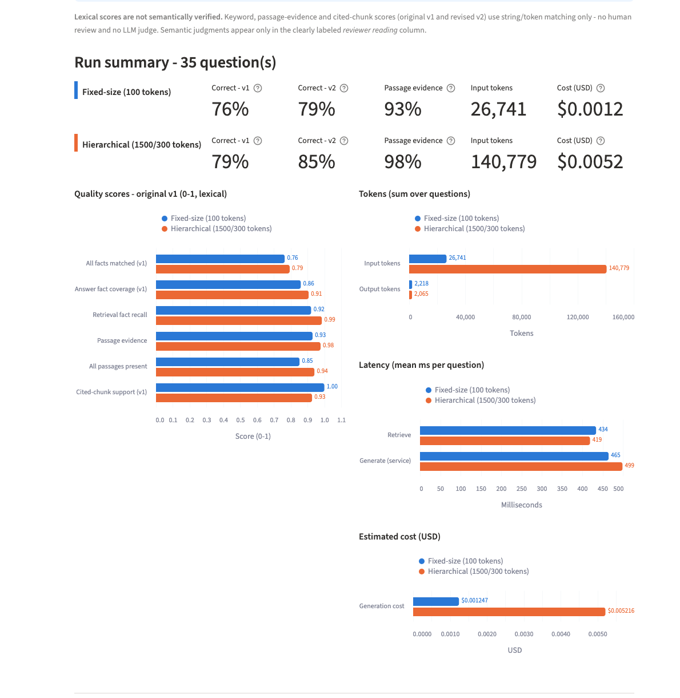
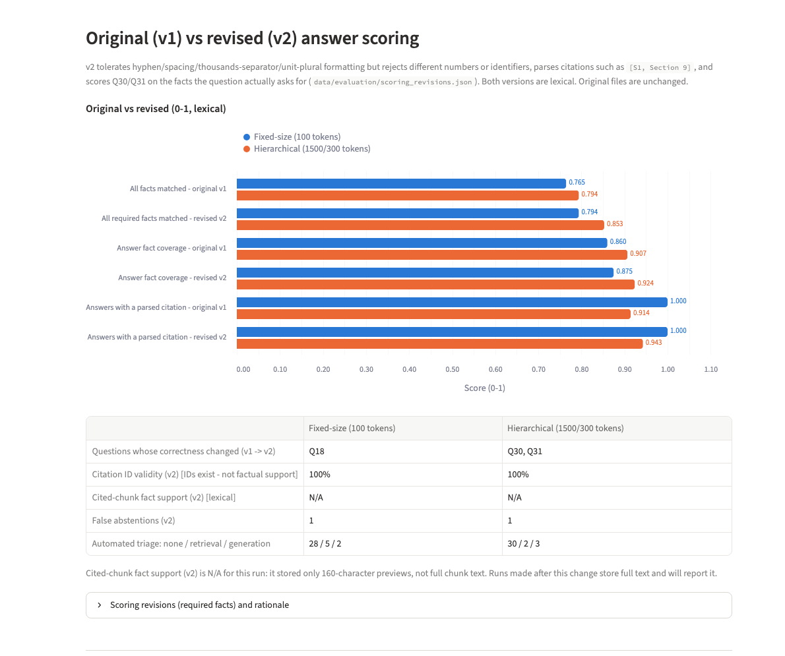
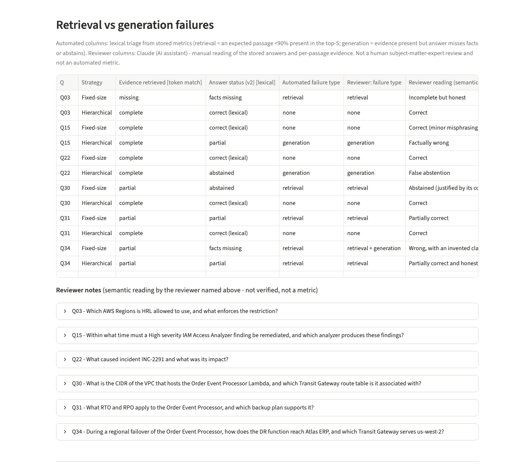
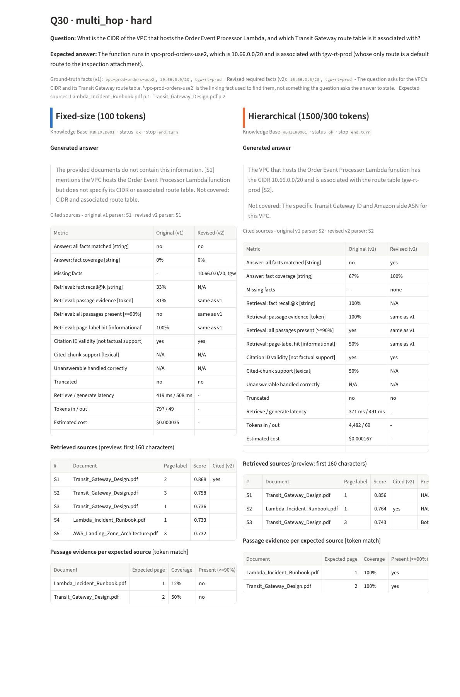

# Evaluating RAG chunking strategies on AWS: Bedrock Knowledge Bases + S3 Vectors

A hands-on, reproducible experiment that compares two retrieval strategies for retrieval-augmented generation (RAG) on AWS - **fixed-size chunking** and **hierarchical chunking** - using Amazon Bedrock Knowledge Bases, Amazon S3 Vectors, Titan Text Embeddings V2 and Amazon Nova Micro, a synthetic 35-question evaluation set, automated lexical scoring, and a read-only Streamlit dashboard.

> **Scope and honesty notes.** This is a learning/portfolio project, not a production system. All documents describe a
> **fictional** company ("Halcyon Ridge Logistics"); every account ID, IP address and name inside them is invented.
> Scores are **lexical** (string/token matching) and come from a **single run** - see [Limitations](#limitations).

**Contents:** [Problem](#business-problem) · [Architecture](#architecture) · [Strategies](#the-two-rag-strategies) ·
[Repository](#repository-layout) · [Quick start](#quick-start-offline) · [Deploy on AWS](#deploy-on-aws) ·
[Workflows](#retrieval-and-generation-workflow) · [Evaluation](#evaluation-methodology) · [Results](#results) ·
[Dashboard](#streamlit-dashboard) · [Screenshots](#aws-console-walkthrough) · [Security](#security-design) ·
[Troubleshooting](#troubleshooting) · [Lessons](#lessons-learned) · [Future work](#future-enhancements)

---

## Business problem

Teams building RAG assistants over internal documents (architecture standards, runbooks, policies, contracts) usually tune chunking by intuition. Chunking decides what evidence the model can see, so a poor choice silently produces incomplete or invented answers. The questions this project answers with evidence rather than opinion:

- Does a more sophisticated chunking strategy retrieve the evidence a question needs more often?
- Do better-retrieved chunks turn into better answers, and at what token cost?
- When an answer is wrong, did **retrieval** fail (evidence never reached the model) or did **generation** fail (evidence was there, the model mishandled it)?
- How trustworthy is automated scoring of RAG answers in the first place?

### Objectives

1. Build a least-privilege, reproducible RAG pipeline on AWS with infrastructure as code.
2. Run a **controlled experiment**: change only the chunking strategy; keep documents, embeddings, retrieval settings, prompt, model and questions identical.
3. Score answers and retrieval automatically, label every metric's limits, and separate retrieval from generation failures.
4. Make results inspectable in a dashboard without any cloud access.

### Use cases this pattern fits

Internal knowledge assistants over runbooks/policies, evaluating chunking before scaling a Knowledge Base, regression-testing a RAG change (model, prompt, chunking) against a fixed question set.

---

## Architecture



| AWS service | Role in this project |
|---|---|
| Amazon S3 | Source documents (`documents/` prefix); SSE-S3, Block Public Access, bucket-owner-enforced, TLS-only bucket policy |
| Amazon Bedrock Knowledge Bases | Managed parse -> chunk -> embed -> store pipeline; `Retrieve` API for semantic search |
| Amazon Titan Text Embeddings V2 | 1024-dimension float32 embeddings for chunks and queries |
| Amazon S3 Vectors | Vector store: one vector bucket, one index per strategy (cosine) |
| Amazon Nova Micro | Answer generation via the Bedrock **Converse** API and the `us.amazon.nova-micro-v1:0` inference profile |
| AWS IAM / STS | Per-KB service roles (trust narrowed to one KB ARN); MFA-gated evaluation runner role |
| Terraform (AWS provider ~> 6.73) | All 24 resources as code |

More diagrams (ingestion and query sequence, IAM trust): [docs/architecture.md](docs/architecture.md).

---

## The two RAG strategies

Both Knowledge Bases read the **same** S3 prefix, use the **same** default parser, the **same** embedding model and dimensions, and identically configured S3 Vectors indexes. Only the data source's chunking configuration differs (`var.experiments` in [infra/variables.tf](infra/variables.tf)).

| | A - fixed-size (baseline) | B - hierarchical (improved) |
|---|---|---|
| Bedrock strategy | `FIXED_SIZE` | `HIERARCHICAL` |
| Settings | `maxTokens = 100`, `overlapPercentage = 1` | parent `1500`, child `300`, `overlapTokens = 60` |
| What is embedded | every 100-token chunk | the 300-token child chunks |
| What `Retrieve` returns | the matching 100-token chunks | the **parent** (1,500-token) chunk of each matching child |
| Expected strength | precise, cheap context | keeps tables, procedures and cross-references together |
| Expected weakness | evidence split across chunk boundaries | much larger prompts; may return fewer than top-k results |

Notes grounded in what we observed:

- `overlapPercentage` has an API minimum of 1, so "no overlap" is approximated by 1% (about 1 token).
- Hierarchical parent chunks carry the page number where the parent *starts*, so page-based metrics under-count it; this is why the evaluation uses a passage-evidence metric (see [Evaluation](#evaluation-methodology)).
- AWS documents that very large hierarchical settings can exceed S3 Vectors metadata limits; 1,500 + 300 tokens stayed well within them (largest observed metadata about 8.6 KB; the indexes use `ENHANCED` mode, which allows up to 100 KB of metadata per vector, versus 40 KB for `CLASSIC` indexes).

---

## Repository layout

```
app/                      Streamlit dashboard (read-only) + results loader
data/documents/           5 synthetic PDFs (fictional company)
data/evaluation/          ground_truth.json (35 Qs), scoring_revisions.json, failure_analysis_<run>.json
docs/                     architecture, deployment, methodology, results, security, decision log, screenshots
experiments/              experiment_config.json - controlled variables, prompt, model settings
iam/                      optional hardening drafts (placeholder account IDs; not applied by Terraform)
infra/                    Terraform (S3, S3 Vectors, Bedrock KBs + data sources, IAM)
results-public/           sanitized evaluation artifacts (identifiers redacted; metrics identical)
scripts/                  data generation, ingestion, evaluation, rescoring, MFA helpers, docs/security tools
tests/                    offline test suite (no AWS calls)
```

Historical diagnostic scripts kept for transparency (not part of the main workflow): `gate3_smoke_test.py` and
`gate3_runtime_test.py` (Claude connectivity attempts via the Anthropic SDK - superseded; they expect runner-policy
statements that were later removed), `accept_model_agreement.py` (accepts a reviewed Marketplace offer exactly once;
requires `--reviewed-offer`, `--expected-account`, `--expected-user`), `nova_connectivity_test.py` (single Nova Micro
Converse call). Their optional dependency is listed in `requirements-dev.txt`.

---

## Quick start (offline)

Everything below runs locally with **no AWS access**.

```bash
python3 -m venv .venv
.venv/bin/pip install -r requirements.txt
.venv/bin/python -m unittest discover -s tests -v      # offline tests (AWS SDK calls are stubbed or not made)

# regenerate the synthetic corpus and ground truth (optional - committed already)
.venv/bin/python scripts/generate_pdfs.py
.venv/bin/python scripts/build_ground_truth.py
.venv/bin/python scripts/validate_dataset.py

# explore the published results
RAG_RESULTS_DIR=results-public .venv/bin/streamlit run app/dashboard.py   # http://127.0.0.1:8501
```

Tested with Python 3.14.2, Terraform 1.6.6, AWS provider 6.73.0, boto3 1.44.9 and Streamlit 1.67.0 on macOS. Other versions are untested.

---

## Deploy on AWS

> Creates billable resources (storage and per-request charges; nothing hourly). Full procedure, costs and teardown: [docs/deployment.md](docs/deployment.md).

**Prerequisites:** an AWS account with Amazon Bedrock in `us-west-2`; access to `amazon.titan-embed-text-v2:0` and the `us.amazon.nova-micro-v1:0` inference profile; Terraform >= 1.6; an IAM identity able to create the resources; an authenticator-app (TOTP) MFA device if you keep the MFA-gated runner role (default).

```bash
# 1. short-lived MFA session stored in profile [hrl-mfa] (prompts for the code; never echoes it)
.venv/bin/python scripts/mfa_session.py
AWS_PROFILE=hrl-mfa .venv/bin/python scripts/check_mfa_session.py      # read-only verification

# 2. infrastructure (review the plan before applying)
cd infra && terraform init
AWS_PROFILE=hrl-mfa terraform plan -out=plan.tfplan
AWS_PROFILE=hrl-mfa terraform apply plan.tfplan
cd ..

# 3. optional hardening: narrow each KB role's trust to its own KB ARN (in-place update)
cp infra/terraform.tfvars.example infra/terraform.tfvars   # fill kb_trust_source_arns from:
(cd infra && terraform output -json kb_trust_source_arns)

# 4. ingest both data sources as the least-privilege runner role, then verify completeness
AWS_PROFILE=hrl-mfa .venv/bin/python scripts/run_ingestion.py
AWS_PROFILE=hrl-mfa .venv/bin/python scripts/check_index_coverage.py     # fails if any PDF < 97% covered

# 5. evaluate (single question first, then all 35 x 2 KBs; cost cap enforced)
AWS_PROFILE=hrl-mfa .venv/bin/python scripts/run_evaluation.py --questions Q18
AWS_PROFILE=hrl-mfa .venv/bin/python scripts/run_evaluation.py --max-cost-usd 0.25

# 6. teardown and verification
(cd infra && AWS_PROFILE=hrl-mfa terraform destroy)
AWS_PROFILE=hrl-mfa .venv/bin/python scripts/verify_cleanup.py
```

`run_evaluation.py` refuses to run if a Bedrock/Anthropic API-key environment variable is set, requires a valid MFA session, assumes the runner role, prints a pessimistic cost estimate and stops if it exceeds `--max-cost-usd` (and stops mid-run if the tracked cost does). Results go to `results/<UTC-timestamp>/` and are rescored automatically with the v2 scorer.

---

## Retrieval and generation workflow



- **Prompt contract** (stored in `experiments/experiment_config.json`, identical for both strategies): use only the numbered sources, cite as `[S#]`, reply with the exact sentence *"The provided documents do not contain this information."* when the context lacks the answer, and mark partial answers with *"Not covered: ..."*.
- If retrieval returns nothing, the runner records the abstain sentence **without** calling the model. AWS errors are recorded as `status=error`, never as answers.
- A configuration fingerprint (hash of retrieval + generation settings) is written to every run's metadata.

---

## Evaluation methodology

Details: [docs/evaluation-methodology.md](docs/evaluation-methodology.md).

**Dataset.** 35 questions over the 5 PDFs: 13 factual, 7 numeric, 6 procedural, 3 conceptual, 5 multi-hop (spanning 2-3 documents) and 1 deliberately unanswerable question. Each answerable question has a verified answer, answer keywords, and source passages whose page numbers were located automatically from the PDF text (`scripts/build_ground_truth.py`, validated by `scripts/validate_dataset.py`).

**Automated scoring (lexical).**

| Metric | What it measures | Limitation |
|---|---|---|
| Expected-fact recall@5 / answer fact coverage | expected facts present in retrieved text / in the answer | wording-sensitive |
| **Passage-evidence coverage** | share of each expected passage's content tokens found in retrieved chunks of the same document | lexical; ignores meaning |
| Page-label hit (informational) | Bedrock page label equals the expected page | under-counts hierarchical parents |
| Abstention correctness / false abstention | exact abstain sentence on unanswerable vs answerable questions | wording-sensitive |
| Citation **ID** validity | every `[S#]` refers to a provided source | **not** factual support |
| Cited-chunk keyword support | stated facts also appear in the cited chunk(s) | lexical, not semantic |

**v1 vs v2 scoring.** v2 ([scripts/scoring_v2.py](scripts/scoring_v2.py)) is a token-sequence matcher that tolerates hyphens, spacing, thousands separators and unit plurals but rejects different numbers or identifiers (e.g. `400` vs `4000`, `us-west-1` vs `us-west-2`), parses citations such as `[S1, Section 9]`, and scores Q30/Q31 on the facts those questions actually ask for (documented in `data/evaluation/scoring_revisions.json`). Original results and v1 metrics are kept; v2 is written alongside (`rescored_v2.*`).

**Retrieval vs generation triage.** Automated (lexical): *retrieval failure* = an expected passage is <90% present in the top-5; *generation failure* = evidence present but the answer misses facts or abstains. A separate **reviewer reading** for Q03, Q15, Q22, Q30, Q31 and Q34 is stored in `data/evaluation/failure_analysis_20261121T231031Z.json`; it is an AI assistant's semantic reading of the stored answers, **not** a human SME review, and it is always shown separately from automated metrics.

---

## Results

<!-- RESULTS:START (generated by scripts/docs/generate_results_doc.py - do not edit by hand) -->
Run `20261121T231031Z` · 70/70 items · model `us.amazon.nova-micro-v1:0` · temperature 0, maxTokens 512 · top-5 · config fingerprint `2631b3d87ad62307` · total tracked cost $0.00646 · errors: 0

| Metric (lexical - not semantically verified) | Fixed-size (100 tokens) | Hierarchical (1500/300 tokens) |
|---|---|---|
| Answer: all expected facts matched - original v1 [string match] | 76.5% | 79.4% |
| Answer: all required facts matched - revised v2 [token match] | 79.4% | 85.3% |
| Retrieval: passage-evidence coverage@5 [token match] | 93.0% | 97.7% |
| Retrieval: all expected passages present@5 | 85.3% | 94.1% |
| Unanswerable question (Q35) handled correctly | True | True |
| Input tokens (35 questions) | 26,741 | 140,779 |
| Mean generation latency (service) | 465 ms | 499 ms |
| Estimated generation cost | $0.001247 | $0.005216 |
<!-- RESULTS:END -->

Full tables (by question type, v1 vs v2, every differing question) are in [docs/results.md](docs/results.md), generated from `results-public/` by `scripts/docs/generate_results_doc.py`.

**Findings (from the artifacts above and the reviewer notes):**

- Hierarchical chunking retrieved complete evidence more often. Automated triage (lexical, revised v2): fixed-size had **5 retrieval** failures (Q03, Q08, Q30, Q31, Q34) and 2 generation failures (Q10, Q21); hierarchical had **2 retrieval** (Q08, Q34) and **3 generation** failures (Q10, Q15, Q22). Q08 and Q10 failed for both strategies.
- Hierarchical chunking used about 5x more input tokens. Its two strategy-specific generation failures were reviewed manually: Q15 gave the value from the wrong row of an SLA table, and Q22 abstained although the evidence was retrieved - long context made the small model err. (Q08 and Q10 were not part of the manual review.)
- Lexical scoring needed revision: hyphenation ("30-second") and scoring keywords the question never asked for produced false negatives; v2 changed exactly three outcomes (Q18 fixed-size; Q30 and Q31 hierarchical).

### Limitations

Single run (no confidence intervals); output wording varied between runs even at temperature 0; lexical scoring cannot verify meaning or detect invented claims that avoid the keywords; 35 questions over ~6K words of synthetic text; one small generation model. Treat the retrieval-quality difference as a clear signal and the answer-accuracy difference as indicative only.

---

## Streamlit dashboard

```bash
RAG_RESULTS_DIR=results-public .venv/bin/streamlit run app/dashboard.py      # http://127.0.0.1:8501
# deep link to a question: http://127.0.0.1:8501/?q=Q30
```

Read-only: it reads local files only and imports no AWS SDK (enforced by `tests/test_dashboard.py`, which renders the app with `boto3`/`botocore` imports and outgoing sockets blocked). `.streamlit/config.toml` binds to `127.0.0.1` and disables usage statistics. Without `RAG_RESULTS_DIR` it uses `results/` if present, otherwise `results-public/`.

| | |
|---|---|
|  |  |
| **Run summary** - correctness (v1 and v2), passage evidence, tokens, latency and cost per strategy. | **Original (v1) vs revised (v2) scoring** - which outcomes changed and why. |
|  |  |
| **Retrieval vs generation failures** - automated lexical triage next to the separately labeled reviewer reading. | **Question detail (Q30)** - answers, citations, retrieved sources, per-passage evidence, v1/v2 metrics side by side. |

---

## AWS Console walkthrough

Console screenshots document each implementation step (S3, S3 Vectors indexes, both Knowledge Bases and their chunking settings, ingestion history, IAM trust policies, CloudTrail evidence of the runner role, Cost Explorer). They are captured manually, redacted irreversibly with `scripts/docs/redact_image.py`, and reviewed before publication.

**Status:** see the numbered checklist and captions in [docs/screenshots/README.md](docs/screenshots/README.md). Screenshots appear there only after they have been captured, redacted and reviewed.

---

## Security design

Details: [docs/security.md](docs/security.md).

- **Least privilege.** One service role per Knowledge Base: read only `documents/*`, invoke only Titan V2, read/write only its own vector index; trust limited to `bedrock.amazonaws.com`, the account, and (after creation) that single KB ARN. The runner role can only `Retrieve` from the two KBs, manage their ingestion jobs, and invoke Nova Micro **only through** the approved US inference profile.
- **MFA-gated, short-lived credentials.** The runner role's trust policy requires `aws:MultiFactorAuthPresent`; workflows use a 1-hour STS session; scripts refuse to run with API-key environment variables set.
- **Verified, not assumed.** Policies were checked with IAM Access Analyzer (`ValidatePolicy`, `CheckNoPublicAccess`) and the IAM policy simulator; the minimum generation permissions were confirmed by assuming the runner role with a restrictive *session policy* and making a single call.
- **Publishing hygiene.** Real account IDs, resource IDs, IAM user names and request IDs are excluded: Terraform state/variables and the original results are git-ignored, `results-public/` is a verified sanitized copy, and screenshots are cropped/filled, re-encoded and metadata-stripped. `scripts/security/scan_public.py` and `detect-secrets` scan every file selected for publication.

---

## Troubleshooting

| Symptom | Cause found in this project | Resolution |
|---|---|---|
| Ingestion job `COMPLETE`, 0 failed, but a `failureReasons` entry "internal error"; one PDF at 90% coverage | Bedrock dropped some chunks silently | Run `check_index_coverage.py`; re-sync skips unchanged files, so replace the data source (`terraform plan -replace=...`, `DELETE` policy removes its vectors) and re-ingest |
| `ParamValidationError: clientToken` | Idempotency token must be 33-256 characters | `run_ingestion.py` uses a SHA-256 hex token with a time-based suffix |
| Model call returns "not available for this account" | Third-party Marketplace model without an active agreement/entitlement | Use a first-party model (this project switched to Nova Micro) or complete model access first |
| 404 "model does not exist" with the Anthropic SDK Mantle client | Mantle endpoint expects bare model IDs, not `us.` inference-profile IDs | Use the matching endpoint/ID pair |
| Page-hit metric 0 for hierarchical although facts were retrieved | Parent chunk labeled with its starting page | Use passage-evidence coverage; treat page labels as informational |
| Correct answer scored wrong ("30-second") | Substring matching | v2 token matching (`scripts/rescore_results.py`) |
| IDE reports `boto3`/`streamlit` unresolved | Editor not using `.venv` | Select the `.venv` interpreter |

---

## Lessons learned

1. **Verify ingestion yourself.** Job statistics reported zero failures while chunks were missing; a coverage check against the source text caught it.
2. **Separate retrieval from generation failures.** The two strategies failed in different places, which an accuracy number alone hides.
3. **Bigger context is not free.** Hierarchical retrieval improved evidence but quintupled input tokens and exposed long-context errors in a small model.
4. **Audit your metrics before trusting them.** Formatting and keyword-scope issues changed three outcomes; label every metric with what it cannot measure.
5. **Model access is an operational dependency.** Plan for agreements, entitlements and endpoint/model-ID differences before the evaluation day.
6. **Test least privilege empirically.** Session policies let you prove which permissions a call really needs without changing IAM.
7. **Gate every cost-incurring step.** The full evaluation cost about a cent; explicit plans, approvals and cost caps made that predictable.

---

## Future enhancements

- Repeat runs (3-5) per strategy with confidence intervals; add more questions and real-world-sized corpora.
- Human or LLM-as-judge semantic grading, kept separate from lexical metrics.
- Tune hierarchical sizes (e.g. 1000/200), add reranking, compare semantic chunking.
- Compare stronger generation models against the same retrieval.
- Store full chunk text for all runs (implemented for future runs) to enable cited-chunk fact support.
- Automated integration tests in a sandbox account; CI for the offline tests and security scans.

---

## License

Apache License 2.0 - see [LICENSE](LICENSE). Dependencies are installed from PyPI under their own licenses (Apache-2.0, BSD, MIT-CMU); none are vendored. The synthetic documents and dataset were generated by this project.
