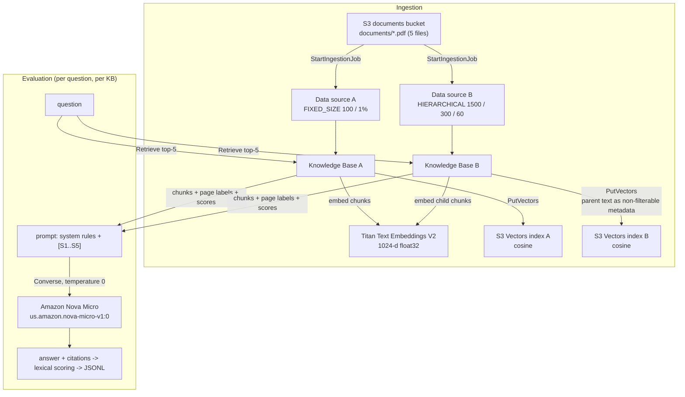
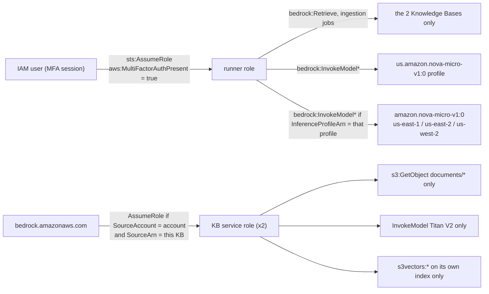

# Architecture

All resources are in one AWS account and Region (`us-west-2`) and are defined in [`infra/`](../infra). Identifiers below
are placeholders.

## Components and data flow

## Resources (24, from `terraform plan`)

| Type | Count | Notes |
|---|---|---|
| `aws_s3_bucket` + public access block + ownership controls + SSE + bucket policy | 5 | private, SSE-S3, ACLs disabled, TLS-only |
| `aws_s3_object` | 5 | the PDFs under `documents/` |
| `aws_s3vectors_vector_bucket` | 1 | SSE-S3 |
| `aws_s3vectors_index` | 2 | 1024 dimensions, float32, cosine, `AMAZON_BEDROCK_TEXT` and `AMAZON_BEDROCK_METADATA` non-filterable |
| `aws_iam_role` + `aws_iam_role_policy` (KB service roles) | 4 | one role per Knowledge Base |
| `aws_bedrockagent_knowledge_base` | 2 | type `VECTOR`, Titan V2, storage `S3_VECTORS` |
| `aws_bedrockagent_data_source` | 2 | `DELETE` data-deletion policy; chunking is the only difference |
| `aws_iam_policy` + `aws_iam_role` + attachment (runner) | 3 | MFA-gated evaluation identity |

No hourly-billed resources (no OpenSearch, provisioned throughput, NAT gateways, KMS keys or compute).

## IAM trust and permissions

## Why S3 Vectors

Pay-per-use vector storage and queries with no provisioned capacity, which suits a low-traffic experiment. Trade-offs
observed: semantic search only (no hybrid keyword search), and hierarchical parent text is stored as vector metadata,
so very large parent sizes can exceed the per-vector metadata limit.
